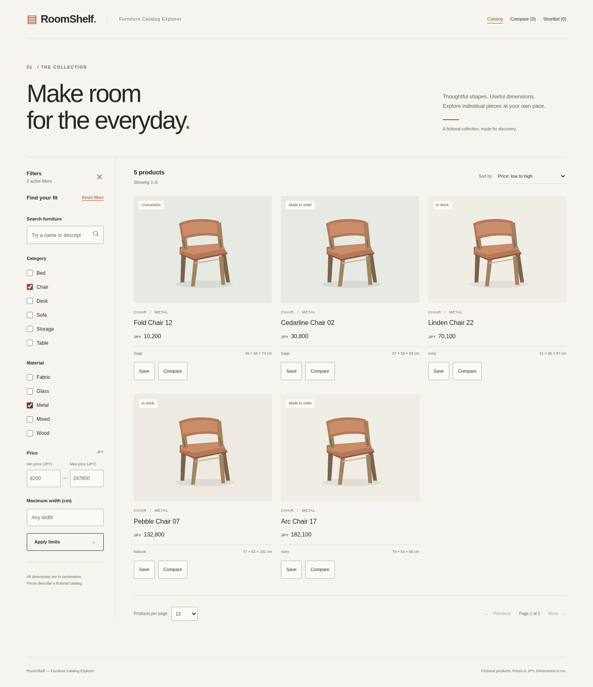
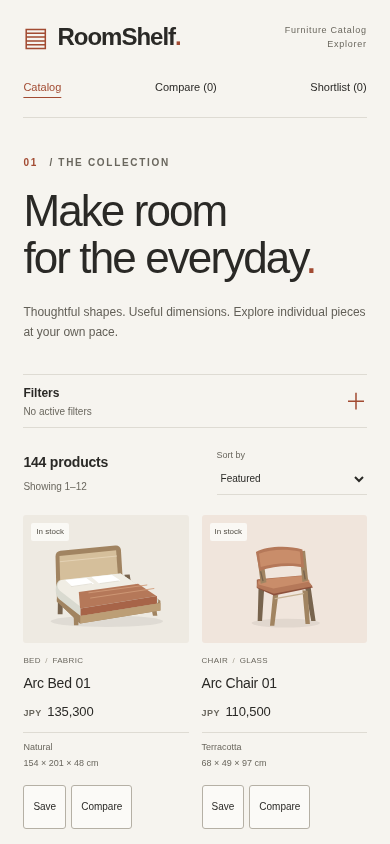
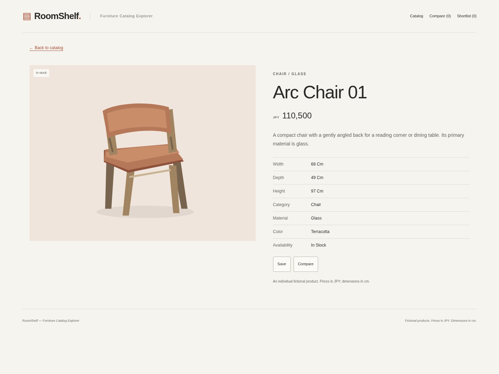
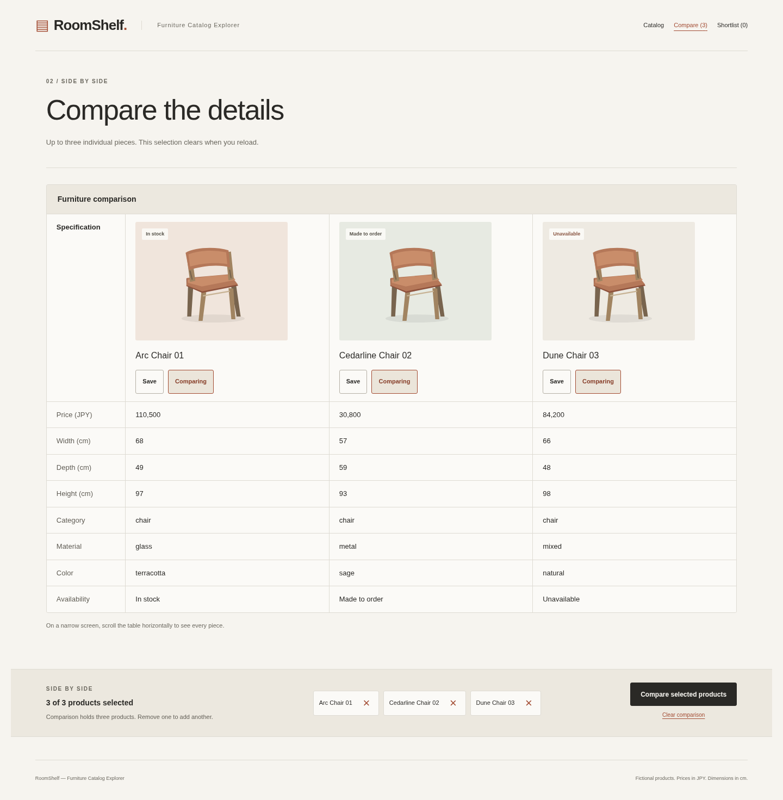

# RoomShelf — Furniture Catalog Explorer

An independently developed furniture catalog with 144 fictional products and original, locally bundled illustrations. Explore individual pieces, compare specifications, and keep an anonymous shortlist without creating an account.



## What you can do

- Search and combine category, material, price, and width filters; sort and paginate results.
- Open product details with descriptions, dimensions, availability, and whole-JPY prices.
- Compare up to three products side by side; selections last for the current page session.
- Save products to a browser-specific shortlist persisted in SQLite for 30 days from creation.
- Share catalog URLs and use browser history without losing applied filters.

This is a software portfolio application, not a retailer. Products, prices, and availability are fictional; dimensions use centimetres. There are no accounts, purchases, uploads, recommendations, analytics, remote APIs, or external shopping links. Normal use needs no external network services.

## Stack and architecture

| Layer | Technologies |
| --- | --- |
| Browser | React 19, TypeScript, Vite, React Router |
| API | Python 3.12, Flask 3, Pydantic validation |
| Persistence | SQLAlchemy 2, SQLite |
| Verification | pytest, Ruff, mypy; Vitest, Testing Library, ESLint, Prettier; Playwright Chromium |
| Automation | GitHub Actions, hashed Python locks, npm lockfiles, dependency advisory audits |

Public catalog reads do not need a session. Comparison lives in React memory. Shortlist membership lives in SQLite and is selected only by a verified signed browser cookie. Development uses Vite's same-origin API proxy. The [architecture diagram and design decisions](docs/ARCHITECTURE.md) explain these boundaries and the hypothetical production requirements.

## Engineering highlights

- **Predictable queries:** applied filters belong to the URL; SQLite performs filtering, counting, ordering, and pagination. Every sort has an ID tie-breaker, and count/rows share a transaction snapshot.
- **Safe writes:** transactional shortlist saves/removals are idempotent, with foreign keys and a composite membership key. Origin and session-bound CSRF checks precede mutation.
- **Bounded recovery:** browser requests have a 10-second deadline, including response consumption. An uncertain mutation result triggers bounded reads to reconcile server state; the write is never automatically replayed. A confirmed CSRF rejection permits one refresh/retry for the same session.
- **Intentional persistence:** sessions have a fixed 30-day expiry; initialization and ordinary seeding preserve existing products and memberships. Comparison and catalog return positions remain in memory.
- **Accessible navigation:** route titles and focus, focus recovery after removals, keyboard controls, mobile filter disclosure, and zoom/reflow have regression tests. Automated checks do not establish full WCAG conformance or replace assistive-technology testing.

## Screenshots

These are unmodified browser captures of the running Flask/React application on a fresh deterministic seed. See [capture states and reproduction](docs/screenshots/README.md) for viewports and interactions.







## Quick start

Requirements: **Python 3.12**, **Node.js 24** (tested patch in `.node-version`), and npm. Dependency installation requires Internet access; running the application requires no API keys.

From the repository root, in one terminal:

```sh
cd backend
python3.12 -m venv .venv
.venv/bin/python -m pip install --require-hashes -r requirements-dev.txt
.venv/bin/flask --app roomshelf init-db
.venv/bin/flask --app roomshelf seed
.venv/bin/flask --app roomshelf run --host 127.0.0.1 --port 5000
```

From the repository root, in another terminal:

```sh
cd frontend
npm ci
npm run dev
```

Open `http://localhost:5173`. Both processes must run: Vite proxies `/api` to Flask on port 5000. Using another browser hostname/port requires a matching `ROOMSHELF_PUBLIC_ORIGIN`; see [configuration and persistence](docs/OPERATIONS.md).

The ignored default database is `backend/instance/catalog.sqlite3`; development generates an ignored random signing key in `backend/instance/session-secret`. Keep both and the browser cookie to preserve shortlist access across restarts. Do not commit either file. Ordinary initialization/seeding are safe to repeat; they do not migrate incompatible schemas. Avoid `seed --reset` unless intentionally discarding the catalog and its dependent memberships.

## Testing and CI

Backend, from `backend`:

```sh
.venv/bin/ruff check .
.venv/bin/ruff format --check .
.venv/bin/mypy roomshelf
.venv/bin/pytest
.venv/bin/pip-audit --cache-dir .venv/audit-cache --strict --disable-pip --require-hashes \
  --vulnerability-service pypi --progress-spinner off -r requirements-dev.txt
.venv/bin/python ../scripts/check_docs.py
```

`pip-audit` is pinned to 2.10.1 in the hash-locked development dependencies. The command audits every pinned runtime/development/transitive requirement against PyPI advisories without resolving a different environment. Strict mode rejects unauditable dependencies; vulnerabilities and advisory-service failures fail the check. A clean result is a point-in-time advisory result, not a security guarantee.

Frontend, from `frontend`:

```sh
npm run lint
npm run format:check
npm run typecheck
npm test
npm run build
npm audit
npm audit --omit=dev
```

Prettier 3.6.2 checks `src/` and `tests/` using `frontend/.prettierrc.json`. Lockfiles, generated output, screenshots, and other directories are outside its scope. A violation fails `format:check`.

Browser checks, from `e2e` after backend/frontend installation:

```sh
npm ci
npm audit
npx playwright install chromium
npm test
```

On Linux, missing browser system libraries require `npx playwright install --with-deps chromium` where package installation is permitted. The [browser guide](e2e/README.md) describes ports, isolated data, browser overrides, and failure artifacts. The suite builds the frontend and starts its own servers; stop local servers on ports 5000 and 4173 first.

GitHub Actions runs on **pushes to `main`**, **pull requests targeting `main`**, and **manual dispatch**. Backend and frontend checks precede browser tests against a fresh seed. Checkout credentials are not persisted and workflow permissions are read-only. Local checks and hosted CI are separate results.

## Security and persistence

- `/api/session` creates/reuses an anonymous session; personal reads never create one implicitly. Signed cookies are host-only, HttpOnly, SameSite=Lax; production also requires Secure and the `__Host-` prefix.
- Every write requires the exact configured Origin and a valid session-bound CSRF token. Tokens stay in memory, expire within an hour, and never outlive the session. Personal responses use `no-store` and vary on Cookie.
- Clearing cookies, replacing the signing key, or reaching the fixed expiry loses access to that shortlist. There is no account recovery. Activity does not extend expiry; expired rows have no automated cleanup command.
- Timeouts do not roll back server transactions. Reconciliation reports the state at the time of its read; a later reload may observe a late commit. Failed recovery releases pending controls and requires a successful reload before another write.

The [API reference](docs/API.md) contains exact request shapes, validation, errors, session creation, and recovery semantics. The [operations guide](docs/OPERATIONS.md) preserves configuration and production-mode security details.

## Limits and deployment considerations

The catalog and all illustrations are bundled; there is no administration interface or image upload. SQLite is appropriate for this small application but has one writer at a time; contention returns bounded API errors. No multi-instance scaling, performance benchmark, schema migration system, backup/restore workflow, or expired-session maintenance has been validated.

A production runtime would need a production WSGI server, same-origin static hosting with SPA fallback, HTTPS termination, stable signing-key storage, and protected durable SQLite storage/backups. Production-mode tests use Flask's simulated HTTPS request environment; they do not validate real TLS, a reverse proxy, or deployed infrastructure. The API-only CSP must not be copied onto the React HTML. **No deployment is provided or claimed.**

Keyboard, contrast, responsive layouts, and real Chromium 200%/400% zoom have automated coverage. Screen-reader behavior and other browser/assistive-technology combinations still need manual assessment.

## Project structure

```text
backend/roomshelf/     Flask API, validation, models, SQL queries, security, seed commands
backend/tests/         API, persistence, configuration, and documentation regression tests
frontend/src/          React routes, URL state, providers, focus/navigation, local SVGs
frontend/tests/        Component, state, recovery, and navigation tests
e2e/                  Real-browser tests and reproducible screenshot capture
docs/                 Public API, architecture, operations, and application screenshots
scripts/check_docs.py JSON-fence and local-image validation
.github/workflows/    Backend, frontend, and browser CI
```
