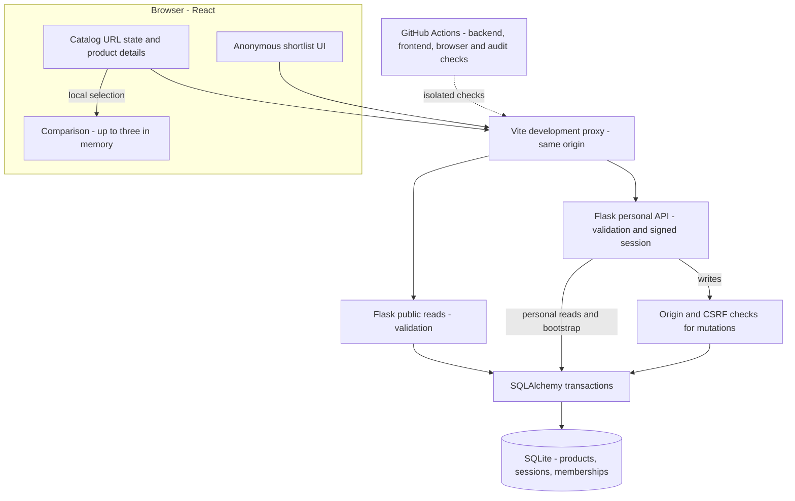

# Implemented architecture

## Local development

This shows actual local development, not a deployed service. Vite serves the frontend and proxies `/api` to Flask. Public catalog/detail reads require no cookie and do not create sessions. React comparison state requires no API. Anonymous shortlist requests use a signed cookie and SQLite membership; the cookie, not a body/query parameter, selects the owner. Personal GETs check an Origin when supplied and reject explicit cross-site Fetch Metadata; every mutation requires the exact configured Origin and a session-bound CSRF token.

## State and database boundaries

Applied search, facets, bounds, sorting, and pagination belong to the URL. Form drafts remain component state until submitted. Browser history restores applied filters without transferring focus on ordinary query changes. Catalog return positions are bounded, in-memory entries associated with navigation history. Restoration waits for matching asynchronous results and metadata, cancels on user interaction, and accounts for reflow.

Python NFKC/casefold normalization is authoritative. SQLAlchemy builds SQLite predicates: OR within facets, AND across facets and search terms, literal escaped search, inclusive numeric bounds. SQLite counts, orders, and pages results. A transaction snapshot keeps count and rows consistent, and ascending product ID breaks every sort tie. The frontend never downloads the whole catalog to implement pagination.

`Product` is the catalog. An anonymous session row has a cryptographically random key and a fixed expiry. Membership rows join that session to a product with a composite primary key and foreign keys. A mutation reserves the SQLite writer before reading and commits before returning success. Duplicate saves keep the first timestamp; repeated removals succeed without changing another session. Ordinary seed inserts missing products and preserves existing edits/memberships; conflicting identities roll back rather than partially seeding.

## Session and uncertain-write handling

`GET /api/session` is the sole bootstrap/renewal endpoint. A signed cookie binds the opaque shortlist key, CSRF nonce, and absolute 30-day expiry. Activity does not refresh it. CSRF tokens last at most one hour, stay in browser memory, and cannot outlive the session. The public `session_ref` is a non-authorizing fingerprint used to detect replacement sessions. Clearing the cookie, expiry, or changing the signing key loses access without account recovery.

The frontend shares bootstrap promises, uses bounded Web Locks where available for first visits across tabs, and serializes writes. Every fetch has a 10-second deadline through body consumption; caller cancellation is distinct. Only an authoritative `csrf_invalid` rejection allows one refresh/retry, and only for the same session. A changed session cancels the action. Timeout, network failure, 5xx, or unreadable write responses never trigger automatic replay: bounded session/shortlist reads reconcile the current state. Failed reconciliation clears pending controls and requires a successful reload. A late server commit may occur after the reconciliation read; that read cannot promise rollback.

## Navigation and verification

Routes set descriptive document titles and move focus to a heading or stable main element; catalog filter changes retain user focus. Removing a comparison/shortlist item selects an adjacent control or empty-state action after confirmed rendering. Native mobile filter disclosure starts collapsed and preserves explicit choices across resizing. Original neutral styling includes measured AA text contrast fixes; keyboard, viewport, and real 200%/400% Chromium zoom/reflow are tested. These checks do not replace manual screen-reader assessment or establish complete WCAG conformance.

Python requirements pin the full runtime/development graph with artifact hashes; npm uses committed lockfiles. Audit tooling and formatting are pinned. The strict Python audit fails on detected advisories, unauditable dependencies, or advisory-service errors. CI runs `npm audit --audit-level=moderate`, so moderate, high, and critical findings fail the check; low-severity findings alone do not. Formatting violations also fail CI. pytest exercises SQLite/API/security, Vitest exercises React state/recovery/focus, and Playwright exercises the actual seeded system. JSON examples are parsed and representative responses are compared with the implementation. No external product API or runtime service is involved.

## Production assumptions, unvalidated

A hypothetical production host would replace Vite/Flask development servers with same-origin static hosting and a production WSGI server behind HTTPS, with SPA fallback. It needs durable SQLite storage, a stable secret, suitable filesystem/backup permissions, and intentional proxy-header handling. There is no deployed architecture, TLS/backup verification, migration workflow, or proven multi-instance topology. See [operations](OPERATIONS.md) for exact configuration and current limitations.
